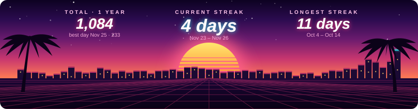

# 🐱 GitHub Streak Card

A commit streak banner for your GitHub profile: a painted sunset waterfront with GitHub graffiti, a cat on the wall, and your streaks in a graffiti font. Rebuilt every 6 hours by GitHub Actions.



- **Current and longest streak with their dates**, private contributions included.
- **Live text, fixed art**: the scene and the graffiti fonts live in `assets/graffiti-template.svg`; each run fills in your numbers.
- **Sized for the profile**: 846×221, the height of the avatar column on desktop.
- **Zero dependencies**: two small Node scripts and the GitHub GraphQL API.
- **Self-hosted**: the SVG lives in your repo, so no third-party card service can go down or rate-limit you.

## Use it on your profile

1. **Fork** this repository (or use it as a template).
2. **Create a token**: Settings → Developer settings → Personal access tokens → *Tokens (classic)*, scopes `repo` and `read:user`. The `repo` scope lets the card count your private contributions; skip it if you only want public ones.
3. **Add the token** to your fork: Settings → Secrets and variables → Actions → New repository secret, name `PROFILE_STATS_TOKEN`.
4. **Run the workflow** once: Actions → *Update streak card* → Run workflow. After that it runs every 6 hours.
5. **Embed the card** in your profile README (`<username>/<username>`):

   ```html
   /github-streak-card/main/assets/streak.svg" alt="Commit streak" width="100%" />
   ```

## Run locally

```bash
GH_TOKEN=$(gh auth token) node scripts/streak.mjs
```

The card is written to `assets/streak.svg`. Requires Node.js 18+.

## How the streak is counted

- A day counts if it has at least one contribution in your GitHub contribution calendar.
- Today without contributions does **not** break the current streak until the day is over.
- The calendar covers the last 365 days, so the longest streak is the longest one within that window.

## Bonus: achievement progress

GitHub shows which achievements you have, but not how far you are from the next tier. `scripts/achievements.mjs` fills the table below with live numbers.

<!-- ACHIEVEMENTS:START -->
| Achievement | Level | Progress to next level |
| --- | --- | --- |
| 🦈 Pull Shark | x3 🥈 | `▓▓░░░░░░░░░░` 132 / 1024 merged PRs |
| 🧠 Galaxy Brain | x3 🥈 | `▓▓▓▓▓▓░░░░░░` 16 / 32 accepted answers |
| ⭐ Starstruck | — | `▓▓░░░░░░░░░░` 2 / 16 stars on top repo |
| ❤️ Public Sponsor | Default | `▓▓▓▓▓▓▓▓▓▓▓▓` 1 sponsorships · max level |

<sub>Updated automatically via the GitHub GraphQL API · 2026-11-26</sub>
<!-- ACHIEVEMENTS:END -->

## License

[MIT](LICENSE)
